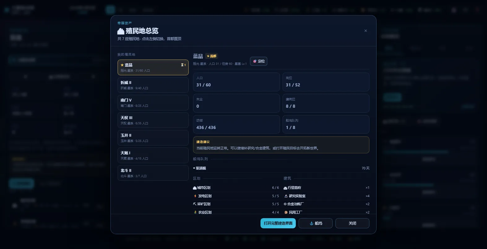

# 群星：微光银河 (Stellaris Mini)

一个能在浏览器里直接玩的《群星》风格迷你 4X 太空大战略游戏。无服务器、无外部依赖、离线可玩：双击 `index.html` 就能开始。





## 快速开始

- **Windows**：双击 `启动游戏.bat`，或直接双击 `index.html`。
- 推荐浏览器：Edge / Chrome（需要支持 Canvas 与 localStorage）。
- 建议窗口：1366×768 以上；1600×900 以上体验最佳。
- 存档写在浏览器 `localStorage` 中，每年自动保存一次，也可以随时点 💾 手动保存。

## 一局怎么玩

你从一颗 20 人口的首都行星出发，目标是**在 2250 年成为银河首强**，或**消灭所有敌对帝国**。

开局六件事：

1. **看右侧舰长任务**：最上方会显示「下一步」，点卡片上的按钮就能直接跳到对应操作。
2. **选研究**：三个领域各点一次「选择科技」。研究不会自动开始。
3. **看科研船和工程船**：科研船自动调查星系，工程船自动建太空站；选中它们，左栏会写清「这艘船做什么」。通常各 1–2 艘足够。
4. **殖民**：第一次发现宜居行星会弹出提示，点「派遣殖民船」；也可以随时点「殖民目标」查看所有候选世界。殖民船在首都造好会自动前往。
5. **管殖民地**：底栏「🏙 殖民地」随时打开殖民地总览，左侧切换所有殖民地，右侧看人口/岗位/区划/建筑/队列，再点「打开完整建造界面」。
6. **造舰队与打仗**：点底栏「⚓ 船坞」造舰。选中舰队后点「🎯 选择攻击目标」，或点底栏「🎯 战争」进入战争指挥：选舰队 → 点敌方殖民地的「派舰队」。舰队会自动战斗、轰炸、占领。

### 核心循环

| 系统 | 说明 |
|---|---|
| 探索 | 科研船调查星系，发现行星、资源点、异常现象；部分星系有原生生物，需要舰队清剿。 |
| 扩张 | 殖民需要合金 + 影响力，目标需在领土 4 跳以内。太空站可以向外延伸领土。 |
| 殖民地 | 底栏「🏙 殖民地」打开总览：所有殖民地、人口、岗位、区划、建筑、队列一页看完；星图上殖民地有菱形标识和名字。 |
| 经济 | 区划提供住房/岗位，建筑提供高级岗位。人口自动分配岗位，产出能量币、矿物、食物、合金、消费品、影响力与凝聚力。 |
| 研究 | 物理/社会/工程三条科技线，共 40+ 项科技，后期有可重复研究。 |
| 传统 | 用凝聚力采纳 9 项传统，费用随已采纳数量上涨。 |
| 外交 | 接触后可赠礼改善关系、宣战、停战。关系会随时间回落到中立。AI 对玩家宣战前会先发**最后通牒**，拒绝才会开战。 |
| 事件 | 30+ 个随机事件，包含多段事件链；同一事件有冷却，不会反复刷同一个商人。 |
| 战争 | 在「🎯 战争指挥」里选舰队、选敌方殖民地，点「派舰队」；舰队进入敌方星系 → 摧毁星际基地 → 轨道轰炸 → 占领。停战时占领区归占领者；战争疲劳到 100 会强制停战。 |
| 胜利 | 2250 年结算分数；或者征服所有其他帝国。 |

### 舰长任务：不知道下一步就点它

右侧「概览」最上方是**舰长任务**卡片。它按顺序给出 7 个目标，并直接带按钮：

1. 选择三个研究项目
2. 调查 3 个星系
3. 建立第一个殖民地
4. 建造 2 座太空站
5. 拥有 5 艘战舰
6. 打开外交面板
7. 占领一座敌方殖民地

卡片上的「选择研究」「打开殖民目标」「打开帝国船坞」「打开外交」「战争指南」都会直接跳到对应界面。点「全部任务」可以看完整清单和每一步的解释。任务完成后会有提示。

### 殖民目标

- 第一次发现宜居行星时，会**自动暂停并弹出发现提示**，可以当场「派遣殖民船」。
- 右侧「殖民地」标签和左栏概览都有「🌱 殖民目标」入口；它会列出所有已调查的宜居世界，标出类型、大小、距离、费用和不能殖民的原因。
- 殖民需要 100 合金 + 40 影响力，目标需在领土 4 跳以内。殖民船在首都建造，完成后自动出发。

### 殖民地总览

- 底栏 **「🏙 殖民地」** 打开殖民地总览：左侧列出全部殖民地（首都置顶），右侧显示人口、住房、岗位、失业、建筑位、防御、船坞队列、区划/建筑摘要和建造建议。
- 在列表里点任意殖民地即可切换查看；底部「打开完整建造界面」进入该殖民地的完整区划/建筑面板，「⚓ 船坞」直接跳到该殖民地的造船队列。
- 右侧面板的「殖民地」标签也按同样顺序列出所有殖民地，每行带「管理」按钮。
- 星图上所有殖民地都有**菱形殖民地标识**，缩放较近时会显示殖民地名字；首都额外有金色虚线圈和「★ 首都」。
- 被占领的殖民地会显示**占领者颜色 + 红色「×」+ 红色虚线环**；左侧行星面板会变成红标「被占领」，并显示占领者横幅。
- 在殖民地面板左上角可以用「◀ / 全部殖民地 / ▶」快速切换。

### 星图颜色

- 领土使用**帝国色块填充**，而不是只靠一圈细线；跨国航道在中点分成两国颜色，边界更容易看出来。
- 左下角有**领土颜色图例**：每个帝国的颜色、是否交战，以及「红叉 = 被占领」「红圈 = 敌方战争目标」「航道半色 = 国界」。
- 低缩放时星体光晕会自动收敛，避免花花绿绿的恒星盖过领土颜色；殖民地和被占领星球会在地图上直接标名字。

### 外交与战争

- 外交面板顶部有一张「外交怎么用」说明卡；每个帝国都显示关系、战力、战争疲劳和你已占领的殖民地。
- 关系降到 -5 以下就可能收到**最后通牒**：支付能量币，或者拒绝并开战；-20 以下进入敌意区。这是明确的选择，不是无预警挨打。
- AI 不会开局就宣战：普通难度最早 2209 年，学徒 2212 年，困难 2206 年；还必须先建立通讯、关系变差、且自认实力占优。
- 真正开战时会出现**战争简报**，告诉你双方战力、敌方为什么宣战，以及四步应对：造舰、集中舰队、守首都、打不过就停战。
- **战争指挥**是打仗的主界面：选中舰队后，点舰队面板的「🎯 选择攻击目标」，或点底栏「🎯 战争」打开。左侧上方选舰队，下面直接列出敌方殖民地（防御、星基等级、当地敌方舰队、距离）和敌方舰队，点「派舰队 / 迎击」就出发，不需要自己在星图上找敌人。
- 星图上敌方殖民地在战争期间会有**红色虚线环**；选中敌方星系时左栏也会出现「派舰队攻击」按钮。
- 敌方舰队进入你的殖民地星系时，屏幕上方会弹出警报并自动暂停。
- 战争流程：舰队进入敌方星系 → 摧毁星际基地 → 轨道轰炸 → 占领行星。停战按现状划界；停战后 5 年不能开战。
- 随时可以点外交面板底部的「战争指南」，或任务卡第 7 步的「战争指南」。

### 事件

- 30+ 个事件，包含远古信标、虫洞、失落殖民地、机械觉醒、海盗王、雇佣兵、时空信标等；部分事件有后续阶段（例如商队加入贸易网络 240 天后回访）。
- 事件有触发间隔和单事件冷却；「星际商队」只会出现一次，不会再反复刷同样的买卖。
- 每个选项都会写清代价和收益，事件按钮上也能直接看到资源变化。

### 建造交互

- 殖民地左栏会显示**建造建议**：例如「合金不足，建议建造合金冶炼厂（+10 合金/月）」，并带一键建造按钮。
- 每条区划/建筑都会标出岗位、产出、住房、造价和耗时；鼠标悬停可看完整说明。
- 建造队列里的每一项都能点「×」取消，返还一半矿物。
- 面板只在需要时刷新；鼠标停在面板上时不会自动重绘，避免点建造时“卡一下”。

### 首都与帝国船坞

- 首都在星图上带有**金色虚线环**和 **「★ 首都」** 标记；右侧「殖民地」、左栏概览、殖民地列表都会把首都排在第一位。
- 底栏的 **「⚓ 船坞」** 随时打开**帝国船坞**：左侧列出所有殖民地，右侧是当前殖民地的船坞队列与舰船建造。每个殖民地队列独立，首都自动排在列表最上方。
- 底栏的 **「🏠 首都」** 一键回到首都星系；右栏「殖民地」里可以进入殖民地总览。
- 船坞界面打开时会暂停，关闭后若此前正在运行会自动恢复速度，建造队列继续推进。

## 操作

- **左键**：选择星系 / 舰队 / 行星。
- **右键**：命令选中舰队前往目标星系（悬停时会显示路线预览）。
- **滚轮**：以鼠标为中心缩放。
- **拖拽**：平移星图。
- **空格**：暂停 / 继续。
- **1 / 2 / 3**：正常 / 2 倍 / 3 倍速度。
- **Esc**：关闭弹窗；没有弹窗时取消选择。
- **H**：帮助 / 教程。
- **F**：回到首都。
- **底栏**：🏙 殖民地总览、⚓ 船坞、🎯 战争指挥、🏠 首都；以及边界/航道/自动暂停开关。

自动暂停默认开启：战斗开始、殖民地建立、科技完成、外交事件时会自动暂停，可在底栏关闭。

## 玩法提示

- 合金是舰船的瓶颈。开局首都只有 1 座合金厂，尽早补第二座。
- 研究实验室可以重复建造，知识就是力量。
- 城市区划提供建筑位；建筑位满了就建城市区划。
- 太空站是前期最划算的矿物/能量来源，工程船会自动铺开。
- 殖民会消耗影响力；影响力不要一直囤着。
- 舰队战力不是简单的数量相加：先升科技、造大船，再考虑决战。
- 敌方的星际基地会参与战斗，进攻前先看清战力对比。
- 占领行星后必须让舰队留在轨道上继续轰炸，防御会缓慢恢复。
- 战争疲劳会随时间上升；劣势方可以求和，优势方也可以见好就收。

### 卡住了怎么办

- **不知道下一步**：点右侧「概览」最上方的舰长任务卡，或点「全部任务」。
- **找不到殖民地/管理**：点底栏「🏙 殖民地」，左侧会列出所有殖民地；星图上殖民地有菱形标识和名字。
- **不知道去哪殖民**：点「🌱 殖民目标」，它会列出所有候选世界和不能殖民的原因。
- **不知道怎么打仗**：点底栏「🎯 战争」或在舰队面板点「🎯 选择攻击目标」；在战争指挥里选舰队、点敌方殖民地的「派舰队」。
- **科研船/工程船在干嘛**：选中它们，左栏「这艘船做什么」会显示自动模式和当前任务。
- **被打了怎么办**：看战争简报；打开帝国船坞造舰，把舰队集中到首都；打不过就在外交面板停战。
- **不知道建筑有什么用**：把鼠标停在区划/建筑行上，会显示岗位、产出、维护、造价和说明；建造建议会直接告诉你缺什么。

## 项目结构

```
stellaris-mini/
├─ index.html            入口
├─ 启动游戏.bat           Windows 快捷启动
├─ css/style.css         界面样式
├─ js/
│  ├─ data.js            科技、建筑、舰船、事件、名称等静态数据
│  ├─ galaxy.js          螺旋银河、超空间航道、行星生成
│  ├─ engine.js          纯逻辑引擎（经济、科研、舰队、战斗、外交、AI）
│  ├─ ui.js              星图渲染、面板、弹窗、教程
│  └─ main.js            启动、主循环、存档
├─ screenshots/          预览图
└─ tools/                无头模拟与浏览器自动化测试
```

引擎不依赖 DOM，可以在 Node 中直接跑完整局模拟：

```bash
node tools/sim.js 20260217 50     # 种子 + 年数
node --check js/engine.js         # 语法检查
```

浏览器交互测试（需要本机安装 Edge）：

```bash
node tools/cdp-test.js            # 启动无头 Edge，点击 UI，跑 54 项断言
node tools/cdp-shots.js           # 生成银河/战斗/科技/结算截图
node tools/cdp-onboard.js         # 生成新手引导/殖民/战争简报截图
node tools/cdp-yard.js            # 生成帝国船坞截图
node tools/cdp-war.js             # 生成殖民地总览/战争指挥/星图标识截图
```

## 说明

- 这是一个粉丝向的迷你致敬作品，灵感来自 Paradox Interactive 的《群星》(Stellaris)。没有使用任何官方素材。
- 单机、离线、无内购、无联网。
- 没有音乐与音效；没有多人模式；没有精细的舰船设计器——这些是刻意省略的，为了把一局压缩到 10–20 分钟。
- 随机种子固定时，银河生成与 AI 行为可复现。

玩得开心，大肥鱼。🐟
